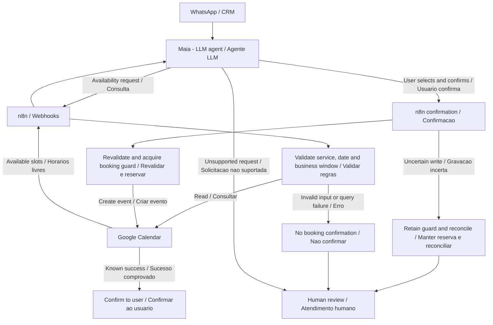

# Case 01 — Architecture / Arquitetura

[English case](../README.md) · [Caso em português](../README.pt-BR.md) · [Mermaid source](appointment-scheduling.mmd)

## Diagram / Diagrama

Simplified logical flow, reconstructed for this case study. Arrows show responsibilities and outcomes, not a verbatim production graph.

Fluxo lógico simplificado, reconstruído para este estudo. As setas representam responsabilidades e resultados, não uma cópia do grafo de produção.

## English — boundaries and decisions

| Component | Responsibility |
| --- | --- |
| WhatsApp / CRM | Conversation entry, history and human service context |
| Maia / LLM | Interpret intent, collect missing details, classify the requested service and invoke supported skills |
| n8n / Webhooks | Validate structured inputs, business window and service/date duration; orchestrate API calls |
| Google Calendar | Return calendar availability and event creation outcomes |
| PostgreSQL booking guard | Serialize confirmations and retain uncertain reservations for reconciliation |
| Human team | Handle exceptions, unsupported rescheduling and unresolved outcomes |

**Availability is a read; confirmation is a separate write.** A previously offered slot can become unavailable. The confirmation path therefore needs fresh validation and coordination before creating an event.

**The workflow owns the rules.** The agent's suggested duration is not authoritative. Classification must distinguish a requested general clinical consultation from vaccination; unclear requests must be clarified instead of silently choosing a service. The agent must not diagnose or select treatment.

**Business time is explicit.** Validate in the configured business timezone and account for appointment end time. The public opening-hour example is synthetic. Full holiday handling, all boundary cases and current deployment settings are not asserted as verified.

**Uncertain writes need reconciliation.** A timeout after a write can leave an event created even when the caller did not receive success. The applied guard retains an uncertain reservation. Check the calendar/event outcome before retrying or releasing it. The guard is a coordination mechanism, not evidence of exactly-once delivery or a complete distributed transaction.

### Failure contract — conceptual documentation

This table describes safe outcome semantics, not the private API's exact schema or a claim that every branch has been tested.

| Outcome | Expected handling |
| --- | --- |
| Invalid service/date/patient | Ask for correction; do not create an event |
| Outside business window | Reject the slot and seek a valid alternative |
| Availability lookup failed | Report inability to check; do not interpret failure as a free slot |
| Slot no longer available | Refresh availability; do not confirm the previous offer |
| Event creation succeeded with known result | Confirm only the validated appointment details |
| Write outcome uncertain | Retain reservation, reconcile and escalate if unresolved |
| Unsupported operation | Transfer to the human team |

**Synthetic walkthrough:** Demo Pet A requests a Saturday clinical visit. The workflow uses 60 minutes. In the fictional 09:00–13:00 Saturday window, 12:30 is invalid and 10:00 is only a candidate until availability and confirmation checks succeed. No real patient, calendar or event is used.

## Português — responsabilidades e decisões

| Componente | Responsabilidade |
| --- | --- |
| WhatsApp / CRM | Entrada da conversa, histórico e contexto do atendimento humano |
| Maia / LLM | Interpretar intenção, coletar dados faltantes, classificar o serviço solicitado e chamar habilidades suportadas |
| n8n / Webhooks | Validar entradas estruturadas, janela comercial e duração por serviço/data; orquestrar chamadas |
| Google Calendar | Retornar disponibilidade e resultado da criação de eventos |
| Proteção de reserva em PostgreSQL | Serializar confirmações e preservar reservas incertas para reconciliação |
| Equipe humana | Tratar exceções, remarcação não suportada e resultados não esclarecidos |

**Disponibilidade é leitura; confirmação é uma gravação separada.** Um horário oferecido pode deixar de estar livre. Por isso, a confirmação precisa de nova validação e coordenação antes de criar o evento.

**As regras pertencem ao fluxo.** A duração sugerida pela agente não é autoridade. A classificação diferencia consulta clínica geral de vacinação; solicitações incertas exigem esclarecimento. A agente não deve diagnosticar nem escolher tratamento.

**O tempo comercial precisa ser explícito.** Validar no fuso configurado e considerar o término do atendimento. O exemplo público de expediente é sintético. Não se declara validação completa de feriados, limites ou configuração atual.

**Gravações incertas exigem reconciliação.** Um timeout após a gravação pode deixar um evento criado sem resposta de sucesso ao solicitante. A proteção aplicada mantém a reserva incerta. Conferir o resultado na agenda antes de repetir ou liberar. Essa proteção coordena confirmações, mas não comprova entrega exatamente uma vez nem uma transação distribuída completa.

### Contrato de falhas — documentação conceitual

A tabela descreve resultados seguros, sem reproduzir o contrato privado da API ou afirmar que todos os caminhos foram testados.

| Resultado | Tratamento esperado |
| --- | --- |
| Serviço/data/paciente inválido | Pedir correção; não criar evento |
| Fora da janela comercial | Recusar o horário e buscar alternativa válida |
| Falha na consulta da agenda | Informar impossibilidade de consulta; não interpretar como horário livre |
| Horário deixou de estar disponível | Consultar novamente; não confirmar a oferta anterior |
| Evento criado com resultado conhecido | Confirmar somente os dados validados |
| Resultado de gravação incerto | Manter reserva, reconciliar e escalar se não resolvido |
| Operação não suportada | Transferir para a equipe humana |

**Exemplo sintético:** Pet Demo A solicita consulta clínica no sábado. O fluxo utiliza 60 minutos. Na janela fictícia de sábado, das 09:00 às 13:00, 12:30 é inválido e 10:00 é apenas candidato até as verificações de disponibilidade e confirmação. Nenhum paciente, calendário ou evento real é utilizado.

## Validation scope / Escopo de validação

Recorded implementation and API checks underpin this retrospective. No live client system was accessed to publish this repository. End-to-end WhatsApp booking, real concurrency and exhaustive API error handling remain validation work.

Este relato usa registros de implementação e testes de API. Nenhum sistema do cliente foi acessado para publicar este repositório. Reserva completa pelo WhatsApp, concorrência real e tratamento exaustivo de erros permanecem pendentes de validação.
